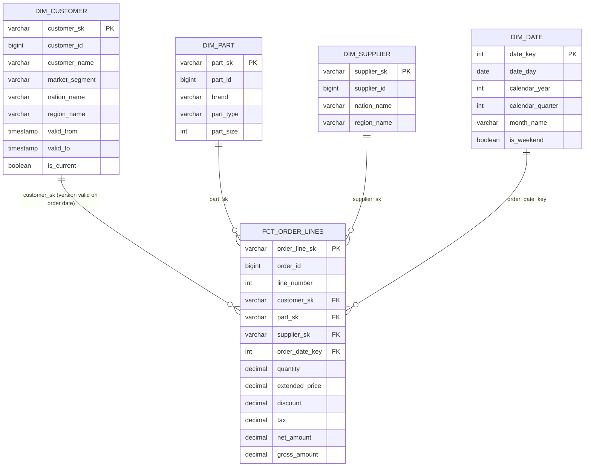

# dbt Kimball TPC-H

[](../../actions/workflows/dbt_build.yml)

A Kimball star schema with SCD Type 2 history, built in dbt on DuckDB. Clone it and run it in five minutes with no warehouse account, no credentials and no cost.

**What it demonstrates**

- A sales fact at a declared grain (one row per order line) with four conformed dimensions
- An SCD Type 2 customer dimension built from a dbt snapshot on a business-effective timestamp
- A point-in-time join, so every sale is attributed to the customer's segment and nation *on the order date*
- 46 automated data tests, including SCD2 integrity and a source-to-fact reconciliation
- CI that rebuilds the warehouse, injects two waves of customer changes and proves the history holds

## Business process and grain

Following the four Kimball design steps:

1. **Business process:** sales order fulfilment.
2. **Grain:** one row per order line (`order_id` + `line_number`), the most atomic level the source offers.
3. **Dimensions:** customer (SCD2), part, supplier, date.
4. **Facts:** quantity, extended price, discount, tax, and derived net and gross amounts. All additive.

## Star schema



Layers: `raw` (loaded by script) → `staging` (views: rename, type, nothing else) → `snapshots` (SCD2 history) → `marts` (tables: the star schema).

## Design decisions

**Hash surrogate keys instead of IDENTITY columns.** In ELT the dimension is rebuilt on every run, so an incrementing integer would change between runs and break anything downstream that stored it. A hash of the business key (plus the version start for SCD2 rows) is stable across rebuilds and can be computed in the fact without a lookup. See [`macros/surrogate_key.sql`](macros/surrogate_key.sql). The date dimension keeps Kimball's smart `YYYYMMDD` integer key.

**SCD2 on a business-effective timestamp, not load time.** The snapshot uses the `timestamp` strategy on the source's `updated_at`, so validity windows land on the business timeline (1992–1998) rather than on whatever day `dbt snapshot` happened to run. That is what makes the point-in-time join meaningful for historical orders.

**Point-in-time join with half-open ranges.** `valid_to` is closed with `9999-12-31`, and the fact joins on `valid_from <= order_date < valid_to`. No null handling, no boundary double-counting, and the overlap test guarantees each order line matches exactly one version.

**Snapshot frequency is a design decision.** A snapshot only sees the source as it is when it runs. CI applies two change events with a build between them, and customers hit by both get three versions. Apply both before a single build and the middle version is lost for good. In production this sets how often the snapshot must run relative to how often the source changes.

**Tests that prove the model, not just the columns.**

| Test | What it guards |
| --- | --- |
| `unique` / `not_null` on every surrogate key | Key integrity |
| `relationships` from each fact key to its dimension | No orphan facts |
| `unique_combination_of_columns` on the fact's grain | Declared grain holds |
| `assert_dim_customer_no_overlap` | SCD2 windows never overlap, so the join can't fan out |
| `assert_dim_customer_one_current` | Exactly one current version per customer |
| `assert_fact_reconciles_to_source` | Row count and extended-price total match the source exactly |

**No package dependencies.** The surrogate key and the grain test are small local macros rather than `dbt_utils`, so the project runs with `pip install` alone.

**Late-arriving dimensions** (not needed for TPC-H, where every order has a known customer): the production pattern is an inferred member, or a `-1` Unknown row in the dimension with `coalesce` on the fact side, so facts never drop out of an inner join.

## Run it

Requires Python 3.10+.

```bash
python -m venv .venv && source .venv/bin/activate   # Windows: .venv\Scripts\activate
pip install -r requirements.txt

python scripts/load_raw.py                          # TPC-H at scale factor 0.1 into tpch.duckdb
dbt build --profiles-dir .                          # snapshot, models and tests: version 1

python scripts/simulate_changes.py --event segment  # 1995-07-01: segment changes
dbt build --profiles-dir .                          # version 2

python scripts/simulate_changes.py --event nation   # 1996-01-01: relocations
dbt build --profiles-dir .                          # version 3

dbt docs generate --profiles-dir . && dbt docs serve --profiles-dir .
```

`load_raw.py` uses DuckDB's built-in TPC-H generator. On a network that blocks DuckDB extension downloads it falls back automatically to a synthetic generator with the same tables and columns (or force it with `--synthetic`). It always starts from a fresh database file.

## Proof of history

The analysis in [`analyses/customer_history_example.sql`](analyses/customer_history_example.sql) lists customers with more than one version and the revenue each version earned. CI prints it on every run. A customer changed by both events:

| customer_id | market_segment | nation_name | valid_from | valid_to | is_current |
| --- | --- | --- | --- | --- | --- |
| 150 | AUTOMOBILE | ALGERIA | 1992-01-01 | 1995-07-01 | false |
| 150 | BUILDING | ALGERIA | 1995-07-01 | 1996-01-01 | false |
| 150 | BUILDING | ARGENTINA | 1996-01-01 | 9999-12-31 | true |

Segment and nation values depend on the generated data; the three validity windows are always the same.

## Project layout

```text
.github/workflows/dbt_build.yml   CI: load, build, two change events, rebuild, docs
scripts/load_raw.py               TPC-H into raw (fresh DB each run)
scripts/simulate_changes.py       Customer change events for SCD2
models/staging/tpch/              Sources and stg_ views
snapshots/snp_customer.yml        SCD2 snapshot, timestamp strategy
models/marts/sales/               dim_customer, dim_part, dim_supplier, dim_date, fct_order_lines
macros/                           surrogate_key, generate_schema_name
tests/                            Singular tests + generic grain test
analyses/                         Customer history example
```

## What I'd add next

- An incremental fact with a lookback window, for daily loads at scale factor 10+
- dbt Semantic Layer metrics (net revenue, average order value) on top of the fact
- A Power BI model over the marts, with the SCD2 customer as a slowly changing slicer
- A run on dbt v2 (the Rust engine), which ships DuckDB support built in

## Stack

dbt Core 1.x · DuckDB · GitHub Actions · TPC-H sample data
